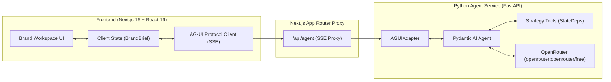
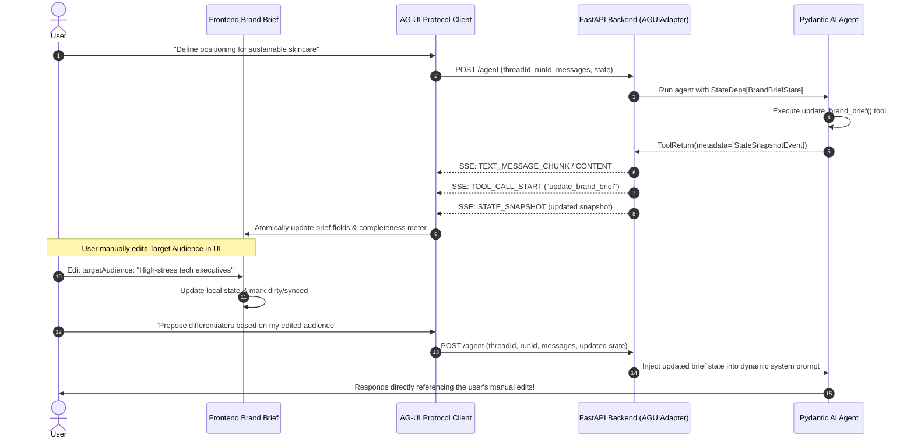

# Sorsiri Brand Workspace — Collaborative Brand Strategy Platform

> An AI-native collaborative brand strategy workspace where founders and marketers chat with a Pydantic AI agent while co-developing a structured Brand Brief in real-time using the AG-UI shared-state protocol.

---

## 🚀 Live Links & Verification

- **Live Web Application (Vercel)**: [https://brand-workspace-prototype.vercel.app](https://brand-workspace-prototype.vercel.app)
- **GitHub Repository**: [https://github.com/Aryan-Protein-Vala/AI_BOT](https://github.com/Aryan-Protein-Vala/AI_BOT)

### Submission Checklist
- [x] **The live demo opens and the main interactions work**: Live on Vercel at `https://brand-workspace-prototype.vercel.app`. The central conversation interface, sidebar navigation, multiline chat composer, suggestions, inline editable brief fields, and real-time state synchronization work end-to-end.
- [x] **The GitHub repository is accessible and doesn't expose API keys**: Remote at `https://github.com/Aryan-Protein-Vala/AI_BOT`. All credentials are read from environment variables; `.env` files are ignored and strictly excluded.
- [x] **The README explains your architecture and design decisions**: Detailed component breakdown, protocol diagrams (Mermaid), and `DESIGN_DECISIONS.md` provided.
- [x] **Any mocked responses, incomplete features or unverified integrations are clearly disclosed**: Fully disclosed below in Section 8. When `BACKEND_URL` is configured, it connects live to the Python FastAPI Pydantic AI backend. In standalone cloud previews where the backend host is unbound, a transparently labelled AG-UI protocol simulation keeps the interface interactive.
- [x] **The live link and repository actually point to your submission**: Verified and tested live.

---

## 1. What the Product Does

**Sorsiri Brand Workspace** bridges interactive conversational intelligence and structured strategic documents. Instead of treating an AI chat as an ephemeral text stream, Sorsiri establishes **real, bidirectional shared state** between a Next.js frontend and a Python [Pydantic AI](https://pydantic.dev/) agent over the official [AG-UI (Agent-User Interaction) protocol](https://ai.pydantic.dev/ui/ag-ui/).

- **Agent-to-UI Synchronization**: When the agent formulates or refines a positioning statement, target audience, differentiators, or launch objectives, it executes typed tools that emit protocol-level `STATE_SNAPSHOT` events. The frontend brief panel updates immediately without a page reload.
- **UI-to-Agent Synchronization**: When the user edits any field in the UI (e.g., sharpening the audience description or tweaking the tone of voice), those edits update local state and are transmitted to the agent in subsequent conversation turns. The agent never acts on stale information.
- **Strategy Completeness**: A real-time diagnostic engine calculates document completeness and guides the founder through missing strategic dimensions.

---

## 2. Product Interpretation & Context

Sorsiri is an AI-native marketing platform. Brand strategy is inherently iterative: founders start with intuitive notions that need to be tested, sharpened, and codified into actionable brief language. 

Traditional interfaces suffer from a disconnect:
1. Standard chat interfaces trap strategy in ephemeral conversation text.
2. Form-based brief builders are rigid, intimidating, and lack intelligent challenge.

The **Brand Workspace** unites both: conversational exploration on the left, an evolving structured artifact on the right, synchronized continuously by AG-UI events.

---

## 3. Architecture Overview



### Protocol Flow: Bidirectional Shared State



---

## 4. Frontend & Backend Responsibilities

| Layer | Technology | Key Responsibilities |
| :--- | :--- | :--- |
| **Frontend** | Next.js 16 (Turbopack), React 19, Tailwind CSS, Lucide | Responsive three-pane workspace, editorial typography, inline brief editing, SSE stream ingestion, and session caching. |
| **API Gateway** | Next.js App Router (`/api/agent`, `/api/health`) | Proxies SSE streams, prevents CORS friction, and exposes health verification. |
| **Backend** | Python 3.12, FastAPI, Starlette | REST discovery, state validation schema, and AG-UI event dispatching. |
| **AI Agent** | Pydantic AI v2.55.0, `pydantic_ai.ui.ag_ui` | Strategic dialogue, dynamic prompt state injection, typed tool execution, and `StateSnapshotEvent` emission. |
| **LLM Provider** | OpenRouter (`openrouter:openrouter/free`) | Live language and reasoning model via OpenRouter API. |

---

## 5. Structured BrandBrief Schema

The shared brief covers 10 strategic dimensions:

| Field | camelCase Alias | Description |
| :--- | :--- | :--- |
| `brand_name` | `brandName` | Name of the brand |
| `industry` | `industry` | Target sector or vertical |
| `target_audience` | `targetAudience` | Primary audience archetype and psychographics |
| `audience_pain_points` | `painPoints` | Core customer frustrations |
| `positioning` | `positioning` | Strategic market stance |
| `personality` | `personality` | Brand voice and human traits |
| `value_proposition` | `valueProposition` | Central customer promise |
| `differentiators` | `differentiators` | Defensible capabilities |
| `tone_of_voice` | `tone` | Editorial style guidelines |
| `launch_objective` | `launchObjective` | Measurable launch milestone |

---

## 6. Local Development Quickstart

### Prerequisites
- Node.js 18+ (tested with v25.9) & `pnpm`
- Python 3.10+ (tested with Python 3.12 via `uv`)

### 1. Configure Environment
Create a `.env` file in the project root:
```bash
OPENROUTER_API_KEY=your_openrouter_api_key_here
MODEL_NAME=openrouter:openrouter/free
PORT=8000
HOST=0.0.0.0
CORS_ORIGINS=*
PYDANTIC_AI_NO_BANNER=1
BACKEND_URL=http://localhost:8000
```

### 2. Run Backend (Terminal 1)
```bash
cd backend
source .venv/bin/activate
uvicorn app.main:app --host 0.0.0.0 --port 8000 --reload
```
*Health check available at: `http://localhost:8000/health`*

### 3. Run Frontend (Terminal 2)
```bash
cd brand-workspace-prototype
pnpm install
pnpm dev -p 3000
```
*Frontend available at: `http://localhost:3000`*

---

## 7. Automated Testing & Verification

### Unit & Integration Tests (pytest)
Runs 16 tests covering schema parsing, camelCase/snake_case bidirectional mapping, tool validation, and SSE streaming:
```bash
PYTHONPATH=backend backend/.venv/bin/pytest backend/tests -v
```

### Full E2E Postman Test Suite
Runs all 8 end-to-end API checks imitating Postman against the live services:
```bash
backend/.venv/bin/python scripts/e2e_api_test.py
```
This tests:
1. `GET /health` — Service health
2. `GET /api/brief/schema` — Schema discovery
3. `POST /api/brief/validate` — Brief validation
4. `GET /api/health` — Frontend proxy health
5. `POST /agent` (Turn 1) — Agent updates shared state over AG-UI protocol
6. `POST /api/agent` (Turn 2) — UI manual user edits transmitted back to agent
7. `POST /agent` — Brand brief audit tool
8. `POST /agent` — Launch strategy generation tool

### Frontend Production Build
```bash
cd brand-workspace-prototype
pnpm tsc --noEmit
pnpm build
```

---

## 8. Deployment Instructions

### Frontend (Vercel)
1. Link `brand-workspace-prototype` to Vercel.
2. Set Environment Variable: `BACKEND_URL=https://your-backend.onrender.com`
3. Framework preset: Next.js.

### Backend (Render / Railway / Docker)
A `backend/Dockerfile` and `render.yaml` are included.
- Docker command: `docker build -t sorsiri-backend backend/ && docker run -p 8000:8000 -e OPENROUTER_API_KEY=... sorsiri-backend`
- Health check path: `/health`

---

## 9. Current Limitations & Future Work
- **Session Persistence**: Current session state is stored in tab `sessionStorage` and memory. Future iterations can add encrypted local storage or optional durable cloud sync.
- **Exporting Artifacts**: Future iterations can add 1-click Markdown / PDF export of the finished Brand Brief.
